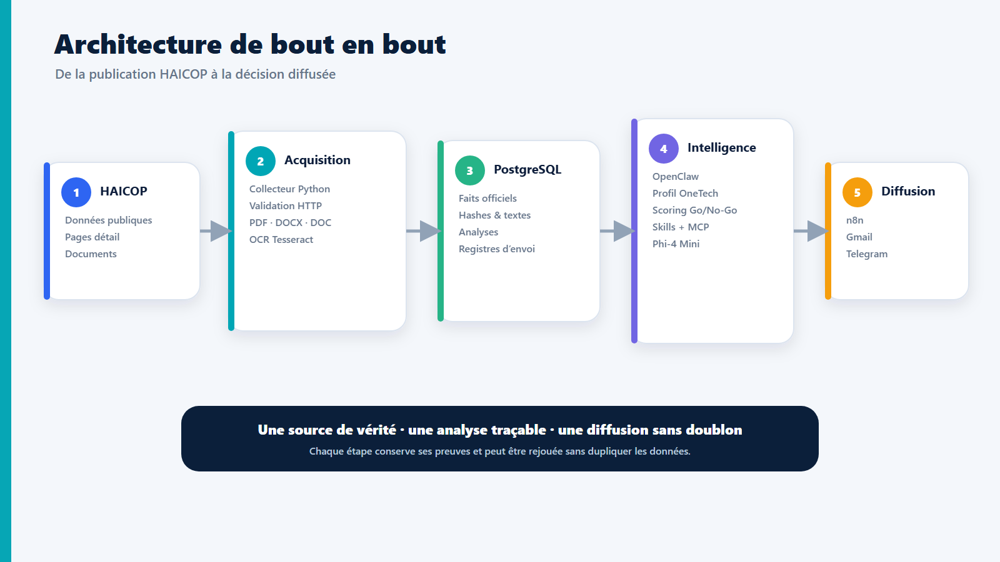
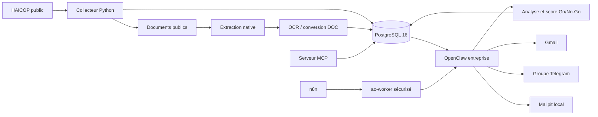
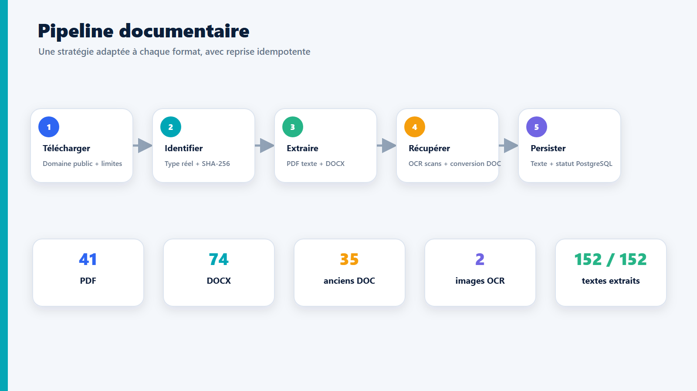
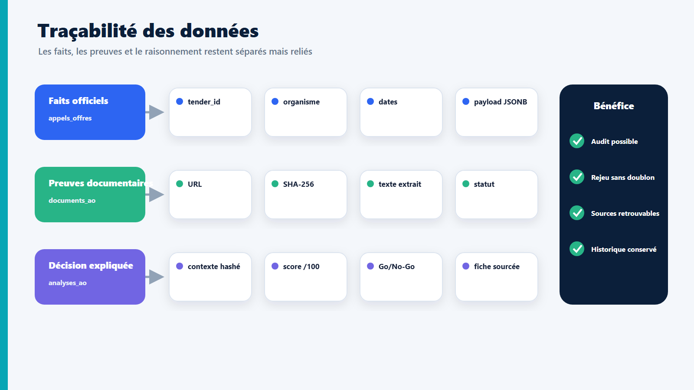
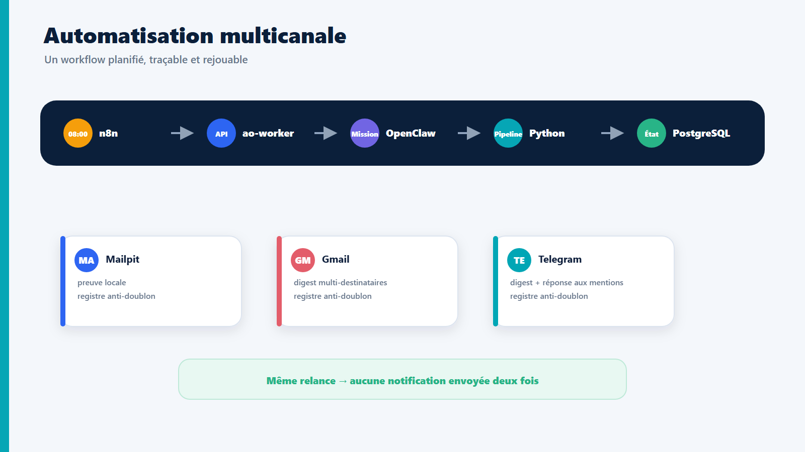
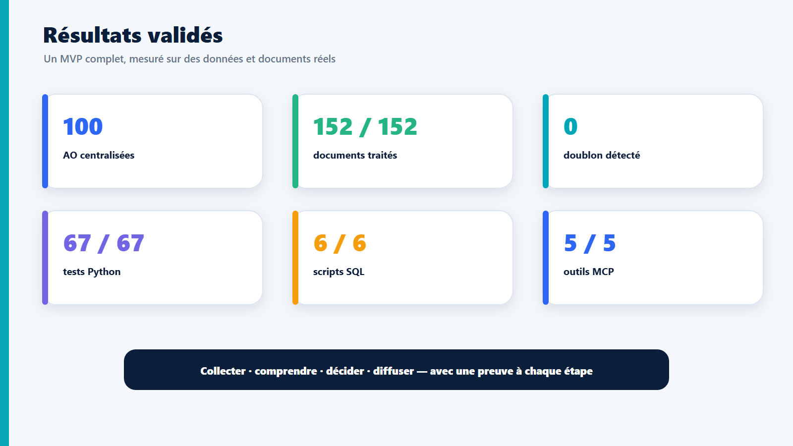

<div align="center">

# OneTech Tender Agent

### Système IA agentique de veille et d’aide à la décision sur les appels d’offres publics


**HAICOP → PostgreSQL → documents/OCR → analyse Go/No-Go → Gmail + Telegram**

[Démarrage rapide](#démarrage-rapide) · [Architecture](#architecture) · [Accès locaux](#accès-locaux-et-identifiants) · [Démonstration](#démonstration) · [Documentation](#documentation-et-livrables)

</div>

---

## Vue d’ensemble

OneTech Tender Agent automatise la veille des appels d’offres publics tunisiens publiés sur HAICOP. Le système collecte les données publiques, télécharge et lit les pièces jointes, applique un filtre de pertinence IT, prépare une analyse traçable et diffuse un digest quotidien aux équipes.

Le projet a été réalisé dans le cadre du stage :

> **Développement d’un système IA agentique pour la gestion des appels d’offres publics**

### Ce que le système apporte

- une base centralisée et dédupliquée des appels d’offres ;
- la lecture automatique des PDF, DOCX, anciens DOC et documents scannés ;
- un scoring transparent avec décision `GO`, `À DISCUTER` ou `NO-GO` ;
- un digest automatique envoyé par Gmail et dans un groupe Telegram ;
- des réponses du bot Telegram aux questions et mentions du groupe ;
- une interface d’orchestration n8n et une interface d’administration PostgreSQL ;
- cinq outils MCP utilisables par OpenClaw, Claude ou un autre client compatible ;
- des sauvegardes vérifiables et une restauration testée.

> [!IMPORTANT]
> Le collecteur utilise uniquement les données et documents publics accessibles sur HAICOP. Il ne contourne aucune authentification TUNEPS.

---

## État vérifié du projet

| Indicateur | Résultat validé |
|---|---:|
| Appels d’offres stockés | **100** |
| Documents enregistrés | **152** |
| Fichiers téléchargés et hashés | **152 / 152** |
| Documents avec texte exploitable | **152 / 152** |
| Formats rencontrés | **41 PDF · 35 DOC · 74 DOCX · 1 PNG · 1 JPEG** |
| Tests Python | **67 réussis** |
| Tests SQL | **6 réussis** |
| Outils MCP | **5 opérationnels** |
| Canaux de diffusion | **Mailpit · Gmail · Telegram** |

### Statut des composants

| Composant | Statut | Rôle |
|---|:---:|---|
| HAICOP collector | ✅ | collecte des AO publiques, détails et liens documentaires |
| PostgreSQL 16 | ✅ | données, analyses, exécutions et preuves d’envoi |
| Traitement documentaire | ✅ | PDF, DOCX, DOC, images, OCR multilingue |
| OpenClaw entreprise | ✅ | orchestration agentique et analyse métier |
| n8n | ✅ | planification les jours ouvrés à 08:00, heure de Paris |
| Gmail | ✅ | digest réel vers plusieurs destinataires |
| Telegram | ✅ | digest de groupe et réponses aux mentions |
| MCP | ✅ | cinq outils standardisés |
| Ollama / Phi-4 Mini | 🧪 | second avis local expérimental |
| Sauvegarde / restauration | ✅ | archive avec checksums et restauration isolée testée |

Le projet se lance manuellement avec une commande documentée, afin de garder un contrôle explicite sur les services locaux.

---

## Architecture

<p align="center">
  
</p>



### Répartition des responsabilités

```text
n8n
└─ déclenche et supervise le scénario quotidien

ao-worker
└─ exécute uniquement les commandes autorisées du pipeline

OpenClaw entreprise
└─ orchestre la collecte, l’analyse et les outils métier

Python / onetech_ao
├─ collecte HAICOP
├─ stockage PostgreSQL et UPSERT
├─ téléchargement, hash SHA-256 et extraction
├─ génération du digest
└─ diffusion idempotente

PostgreSQL
└─ source de vérité : AO, documents, analyses, runs et envois
```

### Vues du système

<table>
  <tr>
    <td width="50%"><br><b>Traitement documentaire</b></td>
    <td width="50%"><br><b>Traçabilité PostgreSQL</b></td>
  </tr>
  <tr>
    <td width="50%"><br><b>Automatisation et diffusion</b></td>
    <td width="50%"><br><b>Résultats du snapshot validé</b></td>
  </tr>
</table>

---

## Accès locaux et identifiants

> [!WARNING]
> Les identifiants ci-dessous concernent uniquement l’environnement local actuel. Ils doivent être remplacés avant tout déploiement partagé, démonstration sur une autre machine ou publication du dépôt.

### Tableau des services

| Service | URL / hôte | Compte | Mot de passe |
|---|---|---|---|
| **n8n** | <http://localhost:5678> | `admin@onetech.com` | `OneTech_n8n#2026!9n8` |
| **pgAdmin** | <http://localhost:5050> | `admin@onetech.com` | `OneTech_Admin#2026!9pG` |
| **PostgreSQL** | `127.0.0.1:5432` | `onetech` | `OneTech_AO#2026_Postgres!7qM` |
| **Mailpit** | <http://localhost:8025> | aucun | aucun |
| **Ollama** | `127.0.0.1:11434` | aucun | aucun |
| **Gateway OpenClaw** | `127.0.0.1:18790` | configuration locale | jeton privé non affiché |

### Connexion PostgreSQL depuis pgAdmin

```text
Nom du serveur       : OneTech PostgreSQL
Host depuis Windows  : 127.0.0.1
Host depuis Docker   : postgres
Port                 : 5432
Maintenance database : onetech_ao
Username             : onetech
Password             : OneTech_AO#2026_Postgres!7qM
```

Le mot de passe pgAdmin ouvre l’interface graphique. Le mot de passe PostgreSQL authentifie pgAdmin, Python ou `psql` auprès de la base : ce sont deux comptes différents.

### Secrets qui ne figurent volontairement pas dans ce README

Les valeurs suivantes restent uniquement dans le fichier local `.env` ou dans la configuration OpenClaw :

- jeton du bot Telegram ;
- jeton du gateway OpenClaw ;
- jeton API de l’automatisation ;
- clé de chiffrement n8n ;
- autorisation OAuth Gmail.

```text
C:\Users\khaye\.openclaw-company\workspace\.env
```

Pour consulter la configuration sur la machine autorisée :

```powershell
Get-Content C:\Users\khaye\.openclaw-company\workspace\.env
```

`.env` et `pgadmin/pgpass` sont ignorés par Git. `.env.example` documente uniquement les variables attendues.

---

## Démarrage rapide

### Prérequis

- Windows 10/11 ;
- Docker Desktop démarré ;
- Python 3.11 ou plus récent ;
- Ollama uniquement pour tester Phi-4 Mini.

### 1. Démarrer la pile

Depuis `C:\Users\khaye\.openclaw-company\workspace` :

```powershell
.\scripts\start-onetech-stack.ps1 -StartGateway -StartOllama
```

Le démarrage est **manuel** et contrôlé par le script ci-dessous.

### 2. Vérifier les conteneurs

```powershell
docker compose ps
```

Les cinq services Docker attendus doivent être actifs : PostgreSQL, pgAdmin, n8n, Mailpit et ao-worker.

### 3. Vérifier l’ensemble du système

```powershell
.\scripts\healthcheck-onetech-stack.ps1 `
  -RequireGateway -RequireOllama -RequireWorkflows -RequireMcp
```

### 4. Arrêter proprement

```powershell
docker compose stop
```

`docker compose down` supprime les conteneurs mais conserve les volumes. Éviter `docker compose down -v`, qui supprime aussi les données persistantes.

<details>
<summary><strong>Installation Python manuelle</strong></summary>

```powershell
py -3 -m venv .venv
.\.venv\Scripts\python.exe -m pip install --upgrade pip
.\.venv\Scripts\python.exe -m pip install -e '.[dev]'
```

</details>

---

## Démonstration

### Scénario recommandé pour la soutenance

1. Ouvrir n8n sur <http://localhost:5678>.
2. Montrer le workflow **OneTech AO - Daily Digest**.
3. Exécuter le workflow manuellement.
4. Vérifier le run et les écritures PostgreSQL.
5. Ouvrir le digest dans Mailpit, Gmail ou le groupe Telegram.
6. Mentionner `@OneTechAOAssistantBot` dans le groupe et montrer sa réponse.
7. Demander à l’OpenClaw entreprise l’analyse d’une AO précise.

Prompt de démonstration :

```text
Analyse l'AO HAICOP Tender-103283 depuis PostgreSQL. Lis toutes les sources,
produis et enregistre la fiche Go/No-Go, vérifie l'enregistrement, puis donne-moi
seulement le résultat synthétique et le chemin de la fiche.
```

Résultat attendu : contexte factuel, lecture des pièces, fiche en neuf sections, notes traçables, décision cohérente et enregistrement sans doublon.

---

## Traitement des documents et OCR

Le pipeline essaie toujours l’extraction native avant l’OCR : un document déjà textuel n’est pas inutilement transformé en images.

```text
Document HAICOP
→ détection du format réel
→ extraction native
→ détection des pages sans texte
→ rendu PNG à 200 DPI si nécessaire
→ OCR Tesseract fra + ara + eng
→ nettoyage et repères de pages
→ stockage PostgreSQL
```

### Formats pris en charge

| Format | Traitement |
|---|---|
| PDF textuel | extraction directe avec conservation des repères de page |
| PDF scanné | pages vides rendues par Poppler puis reconnues par Tesseract |
| PNG / JPEG | OCR Tesseract direct |
| DOCX | extraction Python native |
| ancien DOC | conversion temporaire LibreOffice vers DOCX puis extraction |

Le texte final est enregistré dans `documents_ao.texte_extrait`. PostgreSQL conserve aussi le chemin local, le SHA-256, le type détecté et le statut (`extrait`, `sans_texte`, `non_supporte` ou `echec`).

Garde-fous OCR : maximum 50 pages, 150 Mo d’images temporaires et 90 secondes par opération.

```powershell
docker compose exec -T ao-worker `
  python -m onetech_ao.cli process-documents --limit 50
```

Pour un seul dossier :

```powershell
docker compose exec -T ao-worker `
  python -m onetech_ao.cli process-documents `
  --tender-id Tender-103283 --limit 50
```

> L’OCR n’est pas un modèle de langage. Tesseract reconnaît les caractères ; OpenClaw analyse ensuite le texte obtenu.

---

## Collecte et commandes CLI

Toutes les commandes renvoient du JSON UTF-8 exploitable par OpenClaw et par n8n.

<details open>
<summary><strong>Commandes essentielles</strong></summary>

```powershell
# État, compteurs et intégrité
.\.venv\Scripts\python.exe -m onetech_ao.cli status

# Collecte simple
.\.venv\Scripts\python.exe -m onetech_ao.cli collect --limit 50

# Collecte enrichie avec documents
.\.venv\Scripts\python.exe -m onetech_ao.cli collect `
  --limit 20 --with-details --process-documents

# AO ouvertes
.\.venv\Scripts\python.exe -m onetech_ao.cli list-open --limit 20

# Digest courant
.\.venv\Scripts\python.exe -m onetech_ao.cli digest --limit 10
```

</details>

Options utiles :

- `--since-days N` : limiter aux publications récentes ;
- `--dry-run` : interroger HAICOP sans écrire en base ;
- `--with-details` : récupérer les détails et documents publics ;
- `--process-documents` : télécharger et extraire les documents ;
- `--retry-errors` : rejouer seulement les erreurs ;
- `--reprocess-extracted` : ré-extraire les fichiers déjà présents après amélioration du parseur.

Les écritures utilisent des UPSERT : rejouer la collecte met à jour les mêmes AO au lieu de créer des doublons.

---

## Analyse et scoring Go/No-Go

Les faits officiels et l’analyse IA sont stockés séparément. Une fiche ne peut pas écraser la donnée source HAICOP.

```powershell
.\.venv\Scripts\python.exe -m onetech_ao.cli analysis-context Tender-103283
```

Le contexte généré contient :

- le payload HAICOP d’origine ;
- les champs normalisés ;
- tous les textes extraits ;
- les empreintes et statuts documentaires ;
- le profil OneTech `VALIDATED_V1` ;
- une empreinte du contexte pour empêcher une analyse devenue obsolète.

L’analyse produit une fiche en neuf sections et quatre scores : adéquation, délai, administratif et risque. `record-analysis` contrôle la cohérence entre les notes, le total et la décision.

Règles de prudence :

- une analyse partielle ne peut jamais devenir un `GO` définitif ;
- les AO d’achat matériel sans composante numérique sont pénalisées ;
- un contexte modifié doit être relu avant enregistrement ;
- le texte d’un AO est une donnée non fiable à analyser, jamais une instruction à exécuter.

---

## Automatisation n8n

```text
Jours ouvrés · 08:00 Europe/Paris
        ↓
n8n → ao-worker → OpenClaw entreprise
        ↓
collecte → documents → analyse → digest
        ↓
Mailpit + Gmail + Telegram
```

Workflows actifs dans le volume n8n :

- **OneTech AO - Daily Digest** ;
- **OneTech AO - Telegram Mentions**.

Les fichiers JSON versionnés dans `automation/n8n/workflows/` sont des modèles reproductibles. Leur champ `active: false` ne représente pas l’état du volume n8n en cours d’exécution.

Pour importer ou réparer l’automatisation :

```powershell
.\scripts\activate-daily-automation.ps1
.\scripts\activate-telegram-automation.ps1
```

Mode de diffusion actuellement validé :

```text
AUTOMATION_DELIVERY_ARGS=--mailpit --email --telegram
```

Chaque canal et chaque destinataire possèdent une preuve d’envoi indépendante dans PostgreSQL. Une relance renvoie `deja_envoyee` et ne crée pas de doublon.

---

## Gmail et Telegram

### Gmail

- authentification via OAuth local `gog` ;
- liste de destinataires séparés par des virgules dans `DIGEST_EMAIL_TO` ;
- preuve d’envoi individuelle par adresse ;
- Mailpit conservé comme trace locale et canal de test.

### Telegram

| Élément | Configuration active |
|---|---|
| Bot | `@OneTechAOAssistantBot` |
| Groupe | **OneTech AO - Veille et Analyse** |
| Type | supergroupe |
| Digest quotidien | actif |
| Réponses aux mentions | actif |
| Anti-doublon | actif |

Le bot répond lorsqu’un membre le mentionne ou répond à l’un de ses messages. Le polling conserve un offset et un registre en base pour éviter les doubles réponses. Les prompts du groupe sont traités comme des données non fiables, sans accès aux secrets locaux.

---

## Serveur MCP

Le serveur `onetech-tender` expose exactement cinq outils :

```text
collect_tenders
list_open_tenders
get_tender
analyze_tender
generate_digest
```

Il permet à OpenClaw, Claude ou un client compatible MCP d’utiliser les fonctions du projet sans connaître les commandes internes. Les sorties sont bornées, structurées et expurgent les secrets des erreurs.

---

## Modèle local Phi-4 Mini

`ollama/phi4-mini:latest` est disponible dans l’OpenClaw entreprise comme **second avis expérimental**.

| Critère | Observation |
|---|---|
| Exécution locale | oui |
| Coût API | aucun |
| Confidentialité | traitement sur la machine |
| Vitesse CPU | lente, environ 79 à 105 s par AO pendant le benchmark |
| Fiabilité | peut inventer certaines justifications |
| Usage production | non, second avis uniquement |

Le modèle principal reste celui configuré dans OpenClaw pour l’analyse quotidienne. Phi ne prend jamais seul une décision métier définitive.

---

## Sauvegarde et restauration

Créer une sauvegarde complète :

```powershell
.\scripts\backup-onetech-stack.ps1
```

Tester automatiquement la restauration PostgreSQL dans une base isolée :

```powershell
.\scripts\test-onetech-backup-restore.ps1
```

Restaurer selon la procédure opératoire :

```powershell
.\scripts\restore-onetech-stack.ps1 -BackupPath <chemin_archive>
```

Les sauvegardes contiennent des checksums afin de détecter toute archive incomplète ou modifiée.

---

## Tests et qualité

```powershell
.\scripts\test-database.ps1
.\.venv\Scripts\python.exe -m pytest -q
.\.venv\Scripts\python.exe -m pytest -m 'not integration and not network'
.\.venv\Scripts\python.exe -m pytest -m integration
```

Les tests couvrent notamment :

- UPSERT et absence de doublons ;
- extraction documentaire, OCR et conversions ;
- cohérence des scores et décisions ;
- sécurité des prompts ;
- diffusion idempotente Gmail/Telegram ;
- mentions et réponses Telegram ;
- protocole MCP ;
- migrations PostgreSQL.

Le healthcheck global reste **manuel** :

```powershell
.\scripts\healthcheck-onetech-stack.ps1 `
  -RequireGateway -RequireOllama -RequireWorkflows -RequireMcp
```

---

## Structure du dépôt

```text
.
├── automation/            # worker, prompts et modèles de workflows n8n
├── config/                # profil entreprise et configuration métier
├── database/              # schéma, migrations et tests SQL
├── docs/                  # rapports techniques et procédures
├── fiches/                # fiches Go/No-Go générées
├── livrables/             # présentation, rapport et schémas de soutenance
├── scripts/               # démarrage manuel, tests, backup et restauration
├── skills/                # skills OpenClaw du projet
├── src/onetech_ao/        # package Python principal
├── tests/                 # tests unitaires et d’intégration
├── compose.yaml           # infrastructure Docker
├── .env.example           # variables attendues, sans secrets réels
└── README.md
```

---

## Dépannage rapide

<details>
<summary><strong>Le gateway OpenClaw est indisponible</strong></summary>

```powershell
C:\Users\khaye\.openclaw-company\start-company-gateway.cmd
```

Vérifier ensuite que `127.0.0.1:18790` écoute.

</details>

<details>
<summary><strong>PostgreSQL ou un conteneur est arrêté</strong></summary>

```powershell
docker compose up -d
docker compose ps
.\scripts\apply-database.ps1
```

</details>

<details>
<summary><strong>Le workflow n8n est absent</strong></summary>

```powershell
.\scripts\activate-daily-automation.ps1
.\scripts\activate-telegram-automation.ps1
```

Le JSON monté seul ne suffit pas : l’activation effective est conservée dans le volume n8n.

</details>

<details>
<summary><strong>L’OCR ou la conversion DOC échoue</strong></summary>

```powershell
docker compose exec -T ao-worker tesseract --version
docker compose exec -T ao-worker pdftoppm -v
docker compose exec -T ao-worker libreoffice --headless --version
```

Reconstruire ensuite l’image worker et relancer avec `--retry-errors`.

</details>

<details>
<summary><strong>Aucun email n’apparaît</strong></summary>

Ouvrir Mailpit sur <http://localhost:8025>, vérifier `DIGEST_EMAIL_TO`, `GOG_ACCOUNT` et le registre de diffusion PostgreSQL.

</details>

---

## Documentation et livrables

| Document | Contenu |
|---|---|
| [`database/README.md`](database/README.md) | modèle de données et migrations |
| [`DOCKER_SETUP.md`](DOCKER_SETUP.md) | installation et compréhension de Docker |
| [`docs/OPERATIONS.md`](docs/OPERATIONS.md) | exploitation, sauvegarde et restauration |
| [`HISTORY.md`](HISTORY.md) | historique des décisions et jalons |
| [`livrables/PRESENTATION_SOUTENANCE_FINALE.md`](livrables/PRESENTATION_SOUTENANCE_FINALE.md) | contenu final et notes de la soutenance |
| [`livrables/RAPPORT_STAGE_FINAL.md`](livrables/RAPPORT_STAGE_FINAL.md) | rapport final en source Markdown |
| [`livrables/PRESENTATION_SOUTENANCE_KHAYEM_BEN_GHORBEL.pptx`](livrables/PRESENTATION_SOUTENANCE_KHAYEM_BEN_GHORBEL.pptx) | présentation éditable, 16 diapositives et notes orateur |
| [`livrables/PRESENTATION_SOUTENANCE_KHAYEM_BEN_GHORBEL.pdf`](livrables/PRESENTATION_SOUTENANCE_KHAYEM_BEN_GHORBEL.pdf) | présentation prête à consulter ou imprimer |
| [`livrables/RAPPORT_STAGE_KHAYEM_BEN_GHORBEL.docx`](livrables/RAPPORT_STAGE_KHAYEM_BEN_GHORBEL.docx) | rapport Word éditable |
| [`livrables/RAPPORT_STAGE_KHAYEM_BEN_GHORBEL.pdf`](livrables/RAPPORT_STAGE_KHAYEM_BEN_GHORBEL.pdf) | rapport A4 mis en page |
| [`livrables/ANNEXE_EVALUATION_STAGE_A_FAIRE_REMPLIR_PAR_MAKRAM.pdf`](livrables/ANNEXE_EVALUATION_STAGE_A_FAIRE_REMPLIR_PAR_MAKRAM.pdf) | questionnaire CY Tech à faire signer et joindre au rapport |
| [`docs/DELIVERABLES_FINAL_QA_2026-08-26.md`](docs/DELIVERABLES_FINAL_QA_2026-08-26.md) | contrôle final du rapport, de la présentation et des visuels |

Reproduire les livrables :

```powershell
.\.venv\Scripts\python.exe -m pip install -e '.[deliverables]'
.\.venv\Scripts\python.exe .\scripts\build-livrables.py
.\scripts\export-livrables-office.ps1
```

La génération produit le DOCX, le HTML imprimable et le PPTX éditables. Le
script d’export imprime le rapport HTML en PDF avec Chrome et exporte le
diaporama depuis PowerPoint, de façon reproductible et sans fenêtre visible.

---

## Sécurité et garde-fous

- Les documents d’AO, messages Telegram et contenus externes sont traités comme des données non fiables.
- Les secrets restent dans `.env` ou dans la configuration privée OpenClaw.
- Le worker n’expose qu’un ensemble limité de commandes autorisées.
- Les décisions IA sont assistées, explicables et doivent rester validables par un humain.
- L’OCR peut contenir des erreurs de reconnaissance, surtout sur des scans dégradés.
- Phi-4 Mini est expérimental et ne remplace pas le modèle de production.

---

<div align="center">

### Projet prêt pour démonstration locale

**Collecter · Comprendre · Décider · Diffuser · Tracer**

</div>
